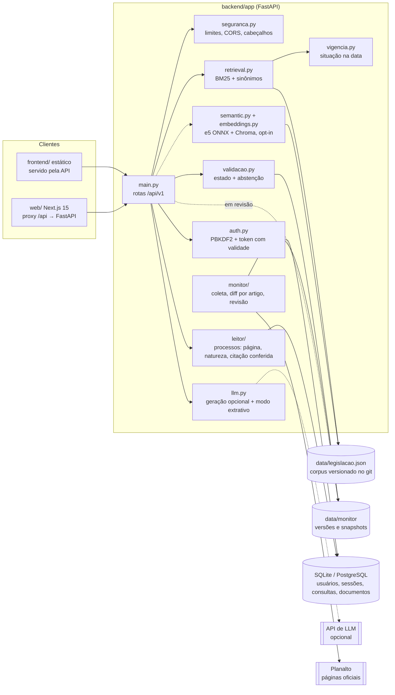

# Arquitetura

> Descreve o código como ele está. O que ainda é plano aparece marcado como **planejado**.

## Visão geral

## Fluxo de uma pergunta

1. `POST /api/v1/perguntar` valida a entrada (3 a 1000 caracteres; `tema` opcional).
2. `Retriever.buscar(..., adaptativo=True)` normaliza a pergunta (minúsculas, sem acento, sem
   stopwords, plural simples), expande sinônimos do vocabulário do cidadão com peso 0,6 e pontua
   os 79 dispositivos com BM25 (palavras-chave curadas pesam 3x). Devolve de 2 a 4 artigos,
   cortando os que têm menos de um terço da nota do 1º.
3. `gerar_resposta` monta o contexto com texto, situação de vigência, nota e fonte de cada artigo e
   chama o LLM. Sem chave, sem rede, com erro ou recusa, devolve `None`.
4. Sem texto do LLM, `resposta_extrativa` lista os artigos com resumo e avisos de vigência.
5. A consulta é gravada na tabela `consultas` (com o usuário, se houver token).
6. A resposta leva `artigos` (com `vigencia`), `gerado_por_llm` e o aviso legal.

Desde o ciclo 5, entre os passos 2 e 3 a resposta passa pela validação (`validacao.py`): abaixo do
limiar de evidência a API se abstém, e toda resposta leva o estado e as verificações. Dispositivos com
mudança pendente no monitor saem marcados como "em revisão".

O fluxo com documento (`/perguntar-documento`) é o mesmo, com os primeiros 4.000 caracteres do
documento somados à consulta de busca; ao prompt do LLM, o documento só vai com consentimento
(`permitir_ia_externa`) e delimitado como dado não confiável.

## Módulos

| Módulo | Responsabilidade | Testes |
|---|---|---|
| `main.py` | rotas, esquemas Pydantic, serviço do frontend estático | `test_api.py`, `test_auth_api.py`, `test_documentos.py`, `test_vigencia.py` |
| `auth.py` | hash de senha (PBKDF2-SHA256, 240 mil iterações), tokens opacos guardados como SHA-256 | `test_auth_api.py` |
| `db.py` | modelos SQLAlchemy (`usuarios`, `tokens_sessao`, `consultas`); `create_all` na importação | indireto |
| `retrieval.py` | BM25 em Python puro, sinônimos, busca adaptativa, `Resultado` com vigência | `test_retrieval.py` |
| `semantic.py`, `embeddings.py` | retriever por embeddings atrás da mesma interface; *fallback* para BM25 | `test_semantic.py` (pulado sem chromadb) |
| `llm.py` | *prompt* com regras de cautela e vigência; modo extrativo | `test_vigencia.py`, `test_api.py` |
| `documentos.py` | extração de texto de PDF/TXT com leitura limitada e limite de páginas | `test_documentos.py`, `test_seguranca.py` |
| `vigencia.py` | situação de vigência na data da consulta (Brasília) | `test_vigencia.py` |
| `seguranca.py` | limitação de requisições, CORS, cabeçalhos | `test_seguranca.py` |
| `ingestao.py`, `ingestao_jurisprudencia.py` | parser do HTML do Planalto e das súmulas → esqueletos para revisão humana | `test_ingestao*.py` |
| `benchmark.py`, `comparacao.py` | benchmark de armadilha temporal; comparação BM25 × semântico × híbrido | `test_benchmark_temporal.py`, `test_comparacao.py` |

## Decisões que valem preservar

- **BM25 como padrão**, medido contra o semântico e o híbrido com julgamento manual (README,
  "Comparação de motores de busca"). O semântico é opt-in e cai no BM25 sem dependências.
- **Vigência é metadado do dispositivo**, não detalhe do texto — decisão sustentada pelo benchmark
  temporal.
- **Ingestão semiautomática**: scripts geram esqueletos com `revisado: false`; um humano escreve o
  resumo e confere a vigência.
- **Funciona sem chave de LLM**: o modo extrativo é um caminho de primeira classe, não um erro.

## Limites estruturais encontrados na auditoria

- O corpus é carregado uma vez na importação de `main.py` (`retriever = criar_retriever()`); mudar o
  JSON exige reiniciar o processo.
- ~~O status de vigência é lido do JSON como está~~ — corrigido no ciclo 1 (`vigencia.py`).
- Sem migrações de banco (`create_all`), colunas novas não chegam a bancos existentes.
- Sem camada de serviço: regras de negócio vivem nas rotas de `main.py`.
- Segurança e privacidade: ver [security-audit.md](security-audit.md).

## Arquitetura-alvo (incremental)

Os módulos novos entram como pacotes ao lado dos existentes, sem reescrever o que funciona:

| Módulo | Estado |
|---|---|
| Leitura de documentos jurídicos (extração por página, peças, linha do tempo, perguntas com citação verificada) | **backend concluído (ciclo 2)**, `app/leitor/` — ver [leitor-de-processos.md](leitor-de-processos.md); interface no ciclo 3 |
| Monitor de mudanças legislativas (snapshots com hash, diff por artigo, fila de revisão) | **concluído (ciclo 4)**, `app/monitor/` — ver [monitor-legislativo.md](monitor-legislativo.md) |
| Estados de validação da resposta e avaliação reproduzível | **concluído (ciclo 5)**, `app/validacao.py`, `app/avaliacao.py` — ver [avaliacao/relatorio.md](avaliacao/relatorio.md) |
| Feedback de usuários, organizações/tenants, planos e limites | **planejado** (fases posteriores) |
