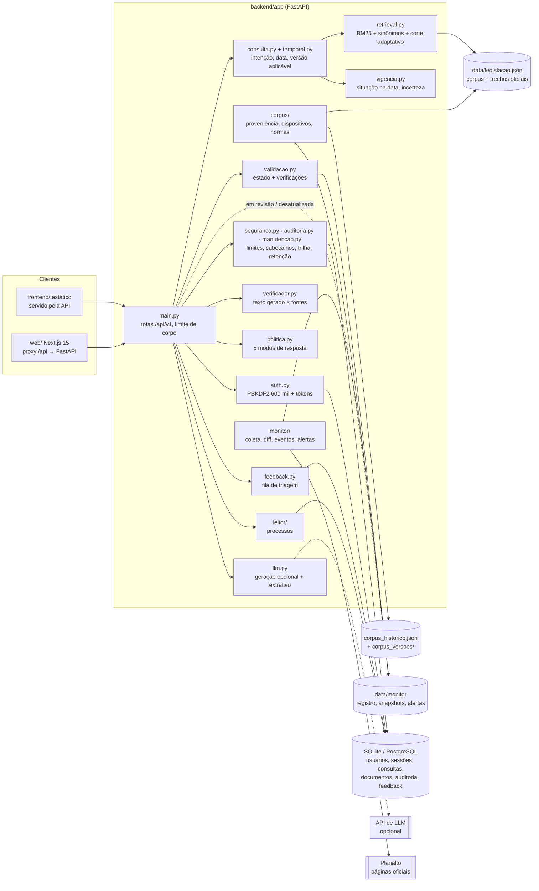

# Arquitetura

> Descreve o código como ele está. O que ainda é plano aparece marcado como **planejado**.

## Visão geral (rodada 9.0)

O corpus só muda por `scripts/corpus.py` (com responsável, motivo e histórico); o monitor só escreve
em `data/monitor`; o feedback só escreve na própria tabela.

## Fluxo de uma pergunta

1. `POST /api/v1/perguntar` valida a entrada (3 a 1000 caracteres; `tema` só da lista do corpus). O
   middleware recusa corpo acima do limite antes de ler tudo.
2. `consulta.consultar` (o mesmo caminho da avaliação) interpreta a pergunta no tempo
   (`temporal.interpretar`: intenção atual, histórica, mudança, revogação ou fundamento; data de
   referência; pedido de esclarecimento quando a data falta ou não existe) e busca com o
   `Retriever` (BM25, sinônimos com peso 0,6, corte adaptativo: o 1º sempre, depois só quem tem ≥ 35%
   da nota dele). Com documento anexado, até 25 termos raros do documento entram com peso 0,3.
3. Abaixo do limiar de evidência, a API se abstém. Senão, as versões de um mesmo dispositivo são
   agrupadas e a aplicável na data de referência vem primeiro; incertezas viram avisos.
4. Dispositivos com mudança pendente no monitor saem "em revisão".
5. `gerar_resposta` chama o LLM, se houver chave, com o contexto (texto oficial separado da
   explicação, vigência, avisos temporais). O texto gerado passa pelo `verificador`; se falhar, não é
   entregue.
6. `validacao.avaliar` produz o estado da evidência (inclui texto conferido, vigência, revisão,
   conflito, atualidade da fonte no monitor); `politica.decidir` escolhe o modo de resposta.
7. A consulta é gravada (sem o texto da pergunta, se não houver conta).
8. A resposta leva `artigos` (com `trechos_oficiais`, `texto_natureza`, `lacunas`, vigência e
   revisão), `temporal`, `validacao`, `politica` e `verificacao_do_texto`.

O fluxo com documento (`/perguntar-documento`) roda em *threadpool*; ao LLM, o documento só vai com
consentimento (`permitir_ia_externa`) e delimitado como dado não confiável.

## Módulos

| Módulo | Responsabilidade | Testes |
|---|---|---|
| `main.py` | rotas, esquemas, limite de corpo, conta (exportar, senha, sessões, excluir) | `test_api.py`, `test_auth_api.py`, `test_seguranca.py` |
| `consulta.py`, `temporal.py` | caminho da pergunta: busca, abstenção, intenção, data, versão aplicável | `test_temporal.py`, `test_benchmark_temporal.py` |
| `retrieval.py` | BM25, sinônimos, corte adaptativo, expansão limitada por documento | `test_retrieval.py` |
| `vigencia.py` | situação na data (Brasília), `nao_verificada` como padrão, `redacao_anterior` | `test_vigencia.py` |
| `validacao.py` | estado da evidência e verificações | `test_validacao.py` |
| `llm.py` | *prompt* (texto oficial × explicação, vigência, tempo), modo extrativo | `test_vigencia.py`, `test_api.py` |
| `verificador.py`, `politica.py` | verificação determinística do texto gerado; modo de resposta | `test_politica.py` |
| `corpus/` | proveniência por dispositivo, extração de trechos, selos, histórico, normas | `test_proveniencia.py` |
| `monitor/` | coleta com retentativas, leitura do tachado, diff por artigo, eventos, dependências, registro com trava, alertas, atualidade | `test_monitor.py`, `test_monitor_operacao.py` |
| `leitor/` | processos: páginas, peças, natureza, decisões, prazos, inconsistências, perguntas | `test_leitor*.py` |
| `feedback.py` | feedback por dispositivo, com máscara de dado pessoal | `test_feedback.py` |
| `auth.py` | PBKDF2-SHA256 600 mil (parâmetros no hash, *rehash*), tokens como SHA-256 | `test_auth_api.py`, `test_seguranca.py` |
| `auditoria.py`, `manutencao.py`, `seguranca.py` | trilha sem dado pessoal; retenção; limites, CORS, cabeçalhos | `test_seguranca.py` |
| `db.py` | `usuarios`, `tokens_sessao`, `consultas`, `documentos_processo`, `eventos_auditoria`, `feedbacks` | indireto |
| `documentos.py`, `ingestao*.py` | extração de PDF/TXT; HTML do Planalto (com o tachado por tag e por estilo) | `test_documentos.py`, `test_ingestao*.py` |
| `avaliacao.py`, `avaliacao_temporal.py`, `calibracao.py` | avaliação reproduzível, portão de regressão, validação cruzada | `test_avaliacao.py` |
| `semantic.py`, `embeddings.py` | retriever semântico opcional | `test_semantic.py` (pulado sem chromadb) |

Scripts: `scripts/avaliar.py`, `scripts/corpus.py`, `scripts/monitor.py`, `scripts/feedback.py`.

## Decisões que valem preservar

- **BM25 como padrão**, medido contra o semântico e o híbrido com julgamento manual (README,
  "Comparação de motores de busca"). O semântico é opt-in e cai no BM25 sem dependências.
- **Vigência é metadado do dispositivo**, não detalhe do texto — decisão sustentada pelo benchmark
  temporal.
- **Ingestão semiautomática**: scripts geram esqueletos com `revisado: false`; um humano escreve o
  resumo e confere a vigência.
- **Funciona sem chave de LLM**: o modo extrativo é um caminho de primeira classe, não um erro.

## Limites estruturais encontrados na auditoria

- O corpus é carregado uma vez na importação de `main.py` (`retriever = criar_retriever()`); mudar o
  JSON exige reiniciar o processo.
- ~~O status de vigência é lido do JSON como está~~ — corrigido no ciclo 1 (`vigencia.py`).
- Sem migrações de banco (`create_all`): tabelas novas (`eventos_auditoria`, `feedbacks`) são criadas
  sozinhas, mas colunas novas em tabelas existentes não chegam a bancos já criados.
- Sem camada de serviço: regras de negócio vivem nas rotas de `main.py`.
- Segurança e privacidade: ver [security-audit.md](security-audit.md).

## Arquitetura-alvo (incremental)

Os módulos novos entram como pacotes ao lado dos existentes, sem reescrever o que funciona:

| Módulo | Estado |
|---|---|
| Leitura de documentos jurídicos (extração por página, peças, linha do tempo, perguntas com citação verificada) | **backend concluído (ciclo 2)**, `app/leitor/` — ver [leitor-de-processos.md](leitor-de-processos.md); interface no ciclo 3 |
| Monitor de mudanças legislativas (snapshots com hash, diff por artigo, fila de revisão) | **concluído (ciclo 4)**, `app/monitor/` — ver [monitor-legislativo.md](monitor-legislativo.md) |
| Estados de validação da resposta e avaliação reproduzível | **concluído (ciclo 5)**, `app/validacao.py`, `app/avaliacao.py` — ver [avaliacao/relatorio.md](avaliacao/relatorio.md) |
| Proveniência por dispositivo, recuperação temporal, verificador e política de resposta | **concluído (rodada 9.0)**, `app/corpus/`, `app/temporal.py`, `app/verificador.py`, `app/politica.py` |
| Monitor como fluxo operacional (simulação, alertas, publicação controlada) | **concluído (rodada 9.0)**; agendado nos dias úteis desde 23/10/2026 |
| Feedback controlado | **concluído (rodada 9.0)**, `app/feedback.py` — ver [feedback.md](feedback.md) |
| Organizações/tenants, planos e limites | **planejado**; nada de cobrança implementado (ver [prontidao-comercial.md](prontidao-comercial.md)) |
